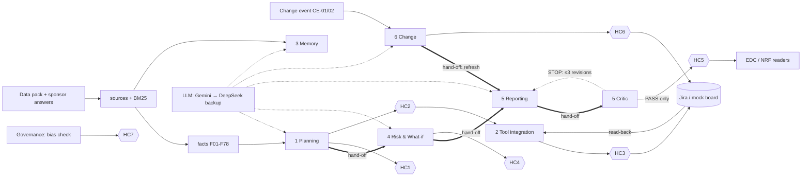

**Team:** [NEEDS INPUT: team name, members and module owned by each — team lead]
**Repository:** `github.com/FrundlesTian/harbourline-pm`, branch `main` (code at commit `eaf958a`) [NEEDS INPUT: confirm submission branch/commit and panel access — team lead]
**Evidence convention:** `path:lines` refers to the repository; `BRIEF-p3-5`, `SA-Q1`, `EDC-2.3`, `NRF-4.2` etc. are the system's own source IDs (Appendix E). Requirement references `L137` are line numbers in `data_pack/00_Brief_UPDATED.txt`.

---

## 1. Purpose, scope and design principles

Six agent modules and a governance layer plan, track and report the Harbourline refurbishment behind one local web UI (`server.py`) and write the approved plan into Jira Cloud. Requirements come from the UPDATED brief (L137–L201) only.

**Core principle — the LLM drafts, deterministic code decides.** It is implemented as four rules:

1. **Facts are verified, not generated.** Report numbers and dates come from facts `F01–F78`, each rejected at load unless its exact quote is in its source chunk (`app/facts_catalog.py:89-108`); conflict detectors CF01–CF12 compute from them (`app/planning.py:219-281`).
2. **The LLM drafts structured content and must cite.** By default the plan, risk register, report bodies and change analysis are generated as JSON carrying source/fact IDs (`app/planning.py:327-483`, `app/risk.py:128-187`, `app/reporting.py:161-238`, `app/change.py:128-182`; grounding rule `app/gen.py:73-76`).
3. **Validators and a Critic check every draft.** Unknown IDs are dropped, WBS must trace to an in-scope line, a date survives only if a cited source states it (`app/planning.py:419-428`), and the Critic traces every number, date and person in a report to what the line cites (`app/critic.py:82-120`).
4. **A curated baseline is the fallback** when no model is configured or validation fails; the reason is recorded (`app/gen.py:61-66`) and shown on the Overview page. The committed evaluation (33/33) runs in this mode (`eval/results/latest.md`).

Human checkpoints HC1–HC7 sit between agent output and anything a stakeholder or the PM tool sees (§4). Open questions and assumptions are kept in the assumption register (**Appendix A**), which the Planning Agent seeds automatically (`app/planning.py:509`).

## 2. Architecture

*Thick arrows (`==>`) are automatic hand-offs, each written to the `handoffs` table by `audit.handoff()` (`app/audit.py:52-57`). Hexagons are human checkpoints. The full diagram is `docs/design/architecture.mmd`.*

**Stack (as built).** Python 3 standard library only: `ThreadingHTTPServer` (`server.py`), vanilla HTML/JS front end (`static/`), SQLite for every store including the audit log (`app/db.py`). The LLM client calls OpenAI-compatible chat endpoints and tries providers in order: **Gemini via Google AI Studio first, DeepSeek as backup** (`app/config.py`, `app/llm.py`). A failed call is logged and retried on the next provider. The PM tool is Jira Cloud REST v3, with a local mock board that implements the same contract (`app/pmtool.py`). Users choose an active identity without a password; role permissions are enforced server-side (`app/auth.py`, `server.py`). There is no Streamlit UI and no JSONL log; the UI runs locally at `http://127.0.0.1:8000` (`app/config.py`).

**One full run** (`app/pipeline.py:21-33`, `POST /api/run`):

1. `init()` chunks the pack into 415 line-addressed chunks, builds the BM25 index, verifies the facts and restores human decisions (`app/pipeline.py:10-18`).
2. **Planning** generates scope, Sponsor Questions, WBS and milestones, runs the conflict detectors, filters untraceable WBS elements and hands the WBS to Risk (`app/planning.py:486-557`).
3. **Risk** generates the register from the seed register, pack evidence and WBS, validates it, computes what-ifs W1–W3 and hands off to Reporting (`app/risk.py:190-231`).
4. **Governance** recomputes the bias check (`app/governance.py:43-107`).
5. **Reporting** drafts the EDC update and NRF report; the Critic checks each draft, and STOP findings go back to the model up to three times (`app/reporting.py:221-238`).
6. Tokens, cost and seconds are recorded per run (`app/audit.py:89-116`).

Then a person approves HC2, Tool integration shows a read-only diff, a person approves HC3 for that diff, and `apply` writes and reads back (`app/pmtool.py:428-538`). Temperature 0.0 plus a response cache keyed on model chain + prompt (`app/llm.py:34-63`) make a re-run on the same database reproduce the plan, register and board, so HC2/HC4 hashes stay valid.

## 3. Agent cards

Role and Context are fixed in `app/agents.py:9-91` (full text: Appendix B). **Model for every LLM call:** Gemini `gemini-2.5-flash` by default (`app/config.py:33`, set by the team in `.env`), DeepSeek `deepseek-chat` as backup (`app/config.py:42`); temperature 0.0 (`app/llm.py:66`). The Gemini path is tested only against a local stub [NEEDS INPUT: one Gemini run log — tool owner].

| **1 Planning Agent** | |
|---|---|
| Role (prompt) | `app/agents.py:10-21`; generation prompts `app/planning.py:327-470` |
| Inputs | Brief chunks, sponsor answers, NRF, EDC, DEL, LL chunks; fact store |
| Outputs | Scope lines SC/OS; Sponsor Questions GQnn with status, answer and assumption; conflict register CF01–CF12; WBS to L3 with dictionary; flagged elements; milestones MSnn with dependencies |
| Tools/APIs | LLM (JSON); validators; conflict detectors (deterministic) |
| Stop condition | Generated plan rejected if <8 scope lines, <10 Sponsor Questions, L1<4 or L3<25, or <8 milestones (`app/planning.py:369-372, 412-413, 468-469`) |
| Failure behaviour | Falls back to baseline tables; reason shown on Overview and in audit as `output generated (baseline)`, outcome `fallback` (`app/gen.py:61-66`) |
| Evidence | Eval T01–T05 (`eval/results/latest.md`); LLM-mode log `docs/design/evidence/eval_llm_deepseek_2026-11-08.log` |

| **2 Tool Integration Agent** | |
|---|---|
| Role (prompt) | `app/agents.py:22-30` — "Deterministic agent - no LLM" |
| Inputs | HC2-approved WBS + milestones; HC6-approved change actions |
| Outputs | Preview (create/update/unchanged + `preview_id`), PM issues, read-back report |
| Tools/APIs | Jira Cloud REST v3 (§5) or mock board, both behind `Guarded` (`app/pmtool.py:343-390`) |
| Stop condition | No write without HC2 for the current plan hash and HC3 for the preview (`app/pmtool.py:431-432, 474-477`) |
| Failure behaviour | Refusal returned and logged `pm sync refused` (blocked); Jira errors surface with a hint (401/403/404) and token redacted (`app/pmtool.py:151-172`) |
| Evidence | Eval T21–T23, T30 (mock board) |

| **3 Memory & Retrieval Agent** | |
|---|---|
| Role (prompt) | `app/agents.py:31-40` |
| Inputs | Question; BM25 top hits; decision log DL-nnn |
| Outputs | Answer with document + line citations, or NOT FOUND with reason; conflict notes; `qa_log` row |
| Tools/APIs | BM25 (`app/sources.py:294-332`); LLM optional synthesis |
| Stop condition | Deterministic sufficiency test: top score <2.5, key-term coverage <70%, or no value where one is asked → NOT FOUND (`app/memory.py:72-83`) |
| Failure behaviour | LLM answer with an unknown citation or untraceable number is rejected and logged; extractive answer used instead (`app/memory.py:101-118`) |
| Evidence | Eval T06–T15 |

| **4 Risk & What-if Agent** | |
|---|---|
| Role (prompt) | `app/agents.py:41-51`; generation prompt `app/risk.py:128-160` |
| Inputs | Seed register (RISK-Rnn), pack chunks, WBS hand-off, conflicts |
| Outputs | Register (L×I, owner, trigger, mitigation, WBS links, sources); seed QA findings; what-ifs W1–W3 (+W4 for CE-02) |
| Tools/APIs | LLM (JSON); validators; deterministic seed QA and what-if arithmetic (`app/risk.py:109-125, 253-333`) |
| Stop condition | Risk dropped if L or I outside 1–5, no valid WBS link, no known source, no owner or trigger; register rejected if <12 valid risks (`app/risk.py:166-179`) |
| Failure behaviour | Baseline register used; reason logged. A missing vendor-change risk is added by the validator (`app/risk.py:180-186`) |
| Evidence | Eval T16, T17 |

| **5 Reporting Agent** | |
|---|---|
| Role (prompt) | `app/agents.py:52-62`; report prompt `app/reporting.py:161-194` |
| Inputs | One fact sheet (facts with quotes), conflicts, change events, NRF/DEL chunks; top-5 risks inserted from the register (`app/reporting.py:197-218`) |
| Outputs | EDC exception update and NRF monthly report, each with a claim list (text, cites, calc) |
| Tools/APIs | LLM (JSON); Critic; line templates (`app/reporting.py:67-125`) |
| Stop condition | Draft only — cannot release; hands to Critic automatically (`app/reporting.py:285-287`) |
| Failure behaviour | Still STOPPED after 3 revisions → template draft used and logged `generated draft rejected - template fallback` (`app/reporting.py:249-255`) |
| Evidence | Eval T18, T25 |

| **5 Critic Agent** | |
|---|---|
| Role (prompt) | `app/agents.py:63-71` — "Deterministic agent - no LLM" |
| Inputs | Draft sections, claims, rendered content |
| Outputs | Findings (rule, severity, detail); report status `critic_passed` / `critic_stopped` |
| Tools/APIs | Number/date/person tracer with a safe formula evaluator (`app/critic.py:62-120`) |
| **Blocker rule** | Any finding of severity STOP blocks release: C1 untraceable number/date/person or uncited claim; C3 missing required section; C4 top five ≠ register; C5 superseded fact or unreflected change event; C6 banned status phrase ("on track", "on programme" …) unless attributed to KHB; C7 conflict line with <2 sources; C8 NRF report without NOT FOUND (`app/critic.py:123-169`) |
| **Max revision loops** | **3** for generated report drafts (`MAX_REVISIONS = 3`, `app/reporting.py:151`); **1** for generated change cost lines, after which untraceable lines are dropped (`app/change.py:165-178`); **0** for template and planted-fault drafts |
| Failure behaviour | STOPPED report is stored with findings; HC5 release refused (`app/reporting.py:291-298`) |
| Evidence | Eval T19 (21/21 planted faults), T20, T28 |

| **6 Change Agent** | |
|---|---|
| Role (prompt) | `app/agents.py:72-81`; analysis prompt `app/change.py:130-158` |
| Inputs | Event JSON (`change_events/CE-01.json`, `CE-02.json`); tags of every stored output |
| Outputs | Stale list; Change Impact Note (cost/time, sponsor decisions, UNRESOLVED); auto-refreshed what-ifs and reports; pending HC6 actions |
| Tools/APIs | Tag matching + milestone dependency walk (deterministic, `app/change.py:38-58, 239-273`); LLM analysis; Critic tracer |
| Stop condition | Never edits baseline, closes or deletes; analysis rejected if <2 traced cost lines or <2 sourced decisions (`app/change.py:199-212`) |
| Failure behaviour | Baseline CE-01/CE-02 analysis used (`app/change.py:65-125`); rejected cost lines logged `reject generated cost line` |
| Evidence | Eval T24–T28 |

| **Governance layer** | |
|---|---|
| Role (prompt) | `app/agents.py:82-90` — deterministic |
| Inputs | Every agent write and approval; `05_Resident_consultation_responses.csv` |
| Outputs | `audit_log`, `approvals`, CSV exports; bias report B1–B6 with actions |
| Tools/APIs | SQLite; theme lexicon en/zh/ms/ta (`app/governance.py:9-41`) |
| Stop condition | Bias check status "awaiting HC7" until signed off (`app/governance.py:100-112`) |
| Failure behaviour | Unknown checkpoint, unnamed approver or invalid decision raises an error (`app/audit.py:60-66`) |
| Evidence | Eval T20, T23, T29, T30 |

## 4. Human checkpoint map

Checkpoints are defined in `app/audit.py`. The server records every approval under the selected session account, never a typed name (`server.py`), and checks that account's role first (`app/auth.py`). Approvals go to the `approvals` table with approver, role, account, decision, comment and timestamp (`app/db.py`) and are mirrored in `audit_log`. Passwordless identity selection means this account label does not verify who clicked the approval.

| ID | What is approved (bound to) | Shown to the approver | Approver role (RBAC) / name | On reject | If skipped, what is stale or unprotected |
|---|---|---|---|---|---|
| HC1 | Scope + Sponsor Questions register (`gaps_hash`) | Planning page: scope, questions, answers, assumptions, conflicts | project_manager / [NEEDS INPUT] | Rejection recorded; plan stays in draft | **Record only:** no code path is blocked by HC1. Questions reach the sponsor unreviewed. |
| HC2 | Plan baseline (`plan_hash` of WBS + milestones) | WBS, dictionary, milestones, dependency issues | project_manager / [NEEDS INPUT] | `preview` refuses to run | **Enforced:** no PM sync is possible (`app/pmtool.py:431-432`); any plan change needs re-approval |
| HC3 | One sync diff (`preview_id`) | Per-item create/update/unchanged list | project_manager / [NEEDS INPUT] | `apply` refuses (`app/pmtool.py:474-477`) | **Enforced:** no write to Jira. Limitation: §8 L2 |
| HC4 | Risk register version (`risk_hash`) | Register, seed QA, what-ifs | group_leader / [NEEDS INPUT] | Rejection recorded | **Record only:** reports still draw top-five risks from an unapproved register |
| HC5 | Release of one report | Report, claims, Critic findings | group_leader / [NEEDS INPUT] | Report stays a draft | **Enforced:** only `critic_passed` drafts can be released (`app/reporting.py:291-301`) |
| HC6 | One change action (re-score, PM comment + label, milestone note, assumption update) | Change Impact Note and the action payload | project_manager / [NEEDS INPUT] | Action marked rejected; nothing applied | **Enforced:** actions apply only in `approve_action` (`app/change.py:373-416`); risks stay at old scores |
| HC7 | Bias & fairness check BIAS-1 | Findings B1–B6, re-weighted ranks, translations | supervisor / [NEEDS INPUT] | Status "rejected" | **Record only:** status shown; no code consumes the consultation summary |

The role strings in `app/audit.py` ("Team PM lead" …) are older labels; the RBAC role is what is checked.

**Not automated, by design.**

- **Moving items to Done, closing, resolving or deleting.** The brief makes these human acts (L247–L248). `Guarded` blocks them and logs `BLOCKED` (`app/pmtool.py:378-390`); the forbidden fields are `status`, `resolution` and `resolutiondate` (`app/pmtool.py:29`). Read-back reports items a human moved to Done (`app/pmtool.py:532`).
- **Sponsor decisions**, such as closure priority (`SA-Q3`), contingency status (`EDC-1.2`) or rooftop deferral (`EDC-6.3`). These appear as decisions with who/when, or as NOT FOUND, never as choices made by the agent (`app/change.py:179-181`).
- **Report release (HC5) and risk re-scoring (HC6).** Agents propose; a person accepts, because the reports go to external bodies and scores drive the top-five list.

## 5. Data contract with the PM tool

| Plan element | PM field | Rule (`app/pmtool.py`) |
|---|---|---|
| WBS L1 / L2 / L3 | Issue type Epic / Task / Subtask | `:41-50`; Jira types resolved by hierarchy level, so localised type names work (`:245-266`) |
| Milestone | Task, summary `[MSnn] Milestone: <name>` | `:52-61` |
| WBS parent | `parent` = parent's issue key | via ext-key map, parents written first (`:485-502`) |
| Dependency | "Blocks" issue link | idempotent; direction learned once and corrected (`:294-317`) |
| Labels | `ai-generated`, ext key, `wbs` or `milestone` | create refused without `ai-generated` (`:356-358`) |
| Due date | `duedate` only for a full ISO date | otherwise "TBD - NOT FOUND" in the description (`:53, 57`) |
| Description | WBS dictionary or milestone note + source citations | `:48, 57` |

**External key and idempotency.** Each item has a stable label key such as `ext-HCH-WBS-1-2-3` (`:37-38`). Sync is (1) lookup by ext key — one search plus a bulk read of keys written before, covering Jira's index lag (`:398-425`); (2) compare a SHA-256 content hash with `pm_sync_map` and the board copy (`:65-67, 461-464`); (3) create, update or no-op (`:489-500`). `change-*` labels from approved HC6 actions survive re-syncs (`:456-458`). Eval T22: second sync 0 created, 0 updated, 92 unchanged.

**Approval bound to the diff.** `preview` hashes the list of (ext key, action, hash) into `preview_id` (`:447`). HC3 approves that ID and `apply` refuses any other (`:474`). `apply` recomputes the actions itself but does not re-check that they still produce the approved ID (limitation L2, §8).

**Read-back reconciliation.** After every apply, `readback` reports missing, mismatched, duplicate, unlabelled and human-Done items, and sets `verified` only if there are no missing, mismatched or duplicate items (`:514-538`).

**Allowed vs refused.**

- **Allowed:** create, update (summary, description, labels, due date, parent), comment, link, and reads.
- **Refused and logged:** delete, close, transition, and any update touching status or resolution (`:363-390`).
- **One exception:** the agent deletes an *issue link* it has just created in the wrong direction, and logs it (`:308-312`). It never deletes an issue.

The passwordless identity screen also has a separate **Reset demo** maintenance operation. It previews all issues in the configured Jira project, requires the project key as confirmation, deletes them child-first, then restores the local baseline. This is outside the agent's guarded PM tool interface; the audit trail records each deletion.

**Jira endpoints:** ten REST v3 endpoints for search, bulk fetch, issue-type metadata, issue create/update, comment, issue links, `myself`, project and link types (`:209-341`; list in Appendix E). Rate limits (429/503) are retried using Retry-After (`:162-163`).

**Jira run.** The team reports that an HC3-approved write and read-back against its Jira Cloud site was tested on another machine (team statement, 8 Nov 2026). The repository holds no export of that run [NEEDS INPUT: audit CSV + approvals CSV export of the Jira run, and project key — tool-integration owner].

## 6. Change handling and staleness

- **Provenance.** Every stored output carries `tags` from a controlled vocabulary (`app/gen.py:14-16`, `app/db.py:1-2`). Generated items may only use these tags (`app/gen.py:57-58`).
- **Detection.** A change event is injected as a dated, numbered source (`CE-01`) without editing the pack (`app/change.py:227-236`). Its tags come from keyword rules (`app/change.py:21-43`).
- **Matching.** An item is stale when it shares a primary tag with the event, or two broad tags (`app/change.py:242-246`). Milestones downstream of an affected milestone are found by a dependency walk (`app/change.py:51-58`). Stale risks, what-ifs, reports and milestones are written to `stale_items` with a reason (`app/change.py:258-273`).
- **Refresh without a manual re-run.** What-ifs and report drafts regenerate immediately; the new reports must cite the event or the Critic stops them (C5) (`app/change.py:280-291`; eval T25, T28).
- **Waiting for HC6.** Risk re-scores, milestone notes, assumption updates and PM comment + label changes are drafted as pending actions and applied only after HC6 (`app/change.py:333-416`). An approved re-score makes the live reports stale and regenerates them (`app/change.py:384-390`; eval T26).

**Week 12 run.** The committed evidence is the evaluation run of CE-01 and CE-02 (eval T24–T28, 6 Nov 2026, baseline mode). The event text was reconstructed by the team [NEEDS INPUT: which event applies to the team (odd/even matriculation digit), wording confirmed against the Week 12 Guide, and the date of the team's own run — change-handling owner].

## 7. Governance, responsible AI and free-tier compliance

**Audit log.** `audit_log(id, ts, run_id, actor, actor_type agent|human|system, action, target_type, target_id, outcome ok|blocked|rejected|fallback|error, detail JSON)` is defined at `app/db.py:61-64` and written by `audit.log()` (`app/audit.py:43-49`). Approvals and hand-offs have their own tables. Audit and approvals export as CSV, and each export is itself logged (`server.py:385-395`). Demo reset never erases the audit, approvals or decision log (`app/pipeline.py:72-80`). Eval T30: 92 PM write rows for 92 issues; no unnamed approvals.

**Guardrails.** One project key, with agent search scoped to project + `ai-generated` (`app/pmtool.py:319-320`); the label is enforced on every create (`:357-358`); no Done/close/delete (§4); unknown API paths default to the most restrictive permission (`server.py:332-340`); generated IDs, scores, dates and numbers are validated before storage (§3).

**Token hygiene.** Keys come only from the environment or a git-ignored `.env` (`app/config.py:13-24`); `.env.example` holds no values; `audit.redact()` masks token patterns before logging (`app/audit.py:33-40`); the Jira health check returns `token_set` as a boolean only (`app/pmtool.py:545-558`); LLM keys travel only in the request header (`app/llm.py:84-91`). A history scan found no committed credential.

**Bias and fairness check** (`app/governance.py:43-107`). The 214 consultation responses are theme-tagged in four languages; raw theme ranks are compared with age-re-weighted and English-only ranks, and channel, age and language skew is reported (B1–B6). Results: residents 65+ are under-represented, an English-only summary would drop most active-ageing and lift comments, and re-weighting changes the top-four order (eval T29). Five actions follow, including holding the summary (D15) for HC7. **What changed as a result:** [NEEDS INPUT: decision at HC7 and resulting change to the consultation summary — governance owner; detail in the Governance Log].

**Tools and free tiers.**

| Tool | Used for | Tier / cost | Brief status |
|---|---|---|---|
| Gemini via Google AI Studio (`gemini-2.5-flash`, configurable) | Primary LLM for all generation | Free tier; price set to 0 (`app/config.py:37-38`) | Permitted (L210-L212) |
| DeepSeek `deepseek-chat` | Backup LLM, used only when Gemini fails | Pay-per-token; measured ~US$0.024 per full fresh run (development run, 8 Nov 2026) | **Not on the permitted list.** It can be switched off with `HCH_LLM_ORDER=gemini`; every required feature also runs in baseline mode at 0 tokens (`eval/results/latest.md`) |
| Jira Cloud | PM tool | [NEEDS INPUT: plan tier — Free?] | Recommended (L232) |
| Python 3 stdlib, SQLite, vanilla JS | Code, storage, UI | Free | Permitted ("with code or without it", L205) |
| OpenAI Agent Builder / ChatGPT agent mode | Not used | — | Prohibited (L239-L240); no such dependency |

The vendor-change risk is logged: R23 in the baseline, and enforced by the validator in generated registers (`app/risk.py:103-105, 180-186`) [NEEDS INPUT: Week 12 re-check of Gemini, DeepSeek and Jira terms, with date — tool owner].

## 8. Design trade-offs and limitations

| # | Decision | Alternative rejected | Reason | Cost |
|---|---|---|---|---|
| T1 | LLM generates structured JSON; deterministic validators and Critic decide; curated baseline as fallback | Free-text LLM output reviewed by people only | Every number becomes checkable; failures degrade to a known-good output, not a blank page | Generated plans differ between fresh databases (only the per-DB cache makes re-runs identical); baseline tables must be maintained |
| T2 | Plain Python stdlib orchestration | OpenAI Agents SDK, CrewAI or LangChain (permitted, L229-L230) | No dependencies to install; hand-offs and gates are explicit code and logged | No framework tracing or tool-calling; the team writes its own loop (the Critic revision loop) |
| T3 | Mock board with the same contract as Jira | Jira-only development | Evaluation and demos run offline without touching the sandbox | Mock evidence is not Jira evidence (§5) |
| T4 | Re-scores and change updates wait for HC6 | Auto-apply re-scores | Scores drive the top-five list in external reports; the brief asks for actions drafted for a human | Stale scores persist until someone approves |
| T5 | BM25 + rule-based sufficiency test for NOT FOUND | Embedding search + LLM judgement | Deterministic, explainable, works with no LLM | Brittle on paraphrase (L3) |
| T6 | Tag-based staleness + milestone dependency walk | Full provenance graph per claim | Simple and auditable; tags are validated against one vocabulary | Coarse: may over-flag; WBS rows are flagged, not regenerated |

**Known limitations.**

- **L1: Generated Sponsor Questions recall.** In LLM mode the generated Sponsor Questions recall 77% (17/22) of the team's gold gaps, below the 80% target; baseline mode recalls 91%. Five further eval cases fail in LLM mode because they pin baseline IDs such as R01, R22 and MS12, not because behaviour fails (`docs/design/evidence/eval_llm_deepseek_2026-11-08.log`).
- **L2: HC3 diff binding.** `apply` does not verify that the current diff still hashes to the approved `preview_id`, so a plan changed after HC3 but re-approved at HC2 could be written under an older HC3 (`app/pmtool.py:472-511`).
- **L3: Memory false NOT FOUND.** "How often does the EDC meet?" returns NOT FOUND although `EDC-1.6` and `EDC-2.3` answer it (re-checked 8 Nov 2026).
- **L4: Checkpoints that only record.** HC1, HC4 and HC7 are recorded and shown but gate no code path (§4).
- **L5: Evidence not in the repository.** There is no committed Jira run, no Gemini run, and no team-run Week 12 evidence.
- **L6: Partial stretch items.** The three what-ifs are shown as cards, not a comparison table. Re-scoring is triggered by change events, not by arbitrary plan edits.
- **L7: Passwordless demo identities.** Anyone who can reach the app can select an active account, including admin. Role permissions still apply to the selected session, but approvals are not proof of a person's identity. Use a protected local demo environment; restore authentication before using this workflow for real approvals or Jira writes.
- **L8: Project-wide reset.** Anyone who can reach the identity screen can preview and confirm deletion of every issue visible to the configured Jira account in the selected project. The operation is irreversible and may partially complete if Jira refuses a later deletion. The local baseline is restored only after all requested Jira deletions succeed.

---

# Appendix A — Assumption register

**Seeding.** There is no standalone assumption file. The register is the Sponsor Question table:

- Every question not answered by a source gets `ASSUMPTION A-nn: until the sponsor answers, plan treats this as unresolved…` (`app/planning.py:509`).
- Approved HC6 actions append event notes, for example "(CE-01)" (`app/change.py:405-412`).
- The rows below are the **baseline** register (`app/planning.py:45-181`, GQ01–GQ20). In LLM mode the IDs and wording are regenerated on each fresh database; the live register is on the Planning page.
- Rows marked **(added)** cover G01–G14 items that the baseline register does not hold as a question.

Owners and revisit triggers are proposals for the team [NEEDS INPUT: confirm owners — team lead].

| ID | Assumption or open question | Source(s) | Sponsor answer | Impact | Owner | Revisit trigger |
|---|---|---|---|---|---|---|
| A-01 | Fixed completion date: 22 months from possession vs fully open by Q4 2028 vs KHB 2028-12-31 vs D22 2028-10-31 | BRIEF-p3-5, EDC-4.1, DEL-D22, NRF-4.2 | SA-Q1 confirms possession from 4 Jan 2027; no single completion date given — remains assumption | Schedule; NRF approval needed after 31 Dec 2028 | project_manager | Programme revision or NRF 4.2 request |
| A-02 | Grant is 60% of eligible cost capped at S$17.0M (max S$10.2M), not 60% of S$18.5M | BRIEF-p3-5, NRF-1.1, NRF-1.2, NRF-1.3 | Unanswered — remains assumption | Council share above 40% of the budget (derived: 18.5 − 10.2 = S$8.3M) | Finance | Fund eligibility ruling (e.g. CE-01) |
| A-03 | ~S$1.18M headroom is not yet contingency; drawdown authority undecided | EDC-1.1, EDC-1.2 | Unanswered — remains assumption | Asbestos S$0.35–0.60M would use 30–51% of it | Finance | EDC decision on contingency |
| A-04 | Childcare handover needed about 7 months before the Jan 2029 intake vs programme month 20 | BRIEF-p3-6, EDC-4.1, DEL-D21, LL-L04 | Unanswered — remains assumption | Childcare opening and T3/T4 timing | project_manager | Operator licensing plan |
| A-05 | No closures are agreed; east-core closure would break barrier-free access to L3–4 | BRIEF-p3-6, EDC-3.1, NRF-5.1 | SA-Q3: no closures agreed; priority is the sponsor's | 6–8 weeks delay if lift works slip (PR3-3) | Sponsor | Closure decision at EDC |
| A-06 | Active ageing operator appointed by Council; EOI needs 3 responses, has 1 | EDC-4.4, DEL-D14 | SA-Q2: Council appoints; no confirmed date | Tranche 2 needs ALL operator agreements (NRF-T2) | Community Engagement | EOI close 2027-04-30 or CE-02 |
| A-07 | Asbestos removal eligibility unknown | EDC-5.1, EDC-6.5, PR3-4 | Unanswered — remains assumption (CE-01 rules it ineligible if that event applies) | Council exposure 40–100% of S$0.35–0.60M (W1) | Finance | Fund ruling |
| A-08 | Rooftop garden kept or deferred; garden ineligible; slab strengthening unpriced | NRF-1.3, EDC-5.2, EDC-6.3 | Unanswered — remains assumption | Cost NOT FOUND; W3 | Sponsor | EDC vote |
| A-09 (added) | EDC cadence: weekly (brief) vs fortnightly from February with alternate-week written updates | BRIEF-p3-7, EDC-1.6, EDC-2.3 | Unanswered — remains assumption | Reporting calendar for the EDC update | project_manager | Next EDC terms of reference |
| A-10 (added) | Monthly NRF report due by the 10th working day; February report was late; a second late report risks suspension | NRF-3.1, NRF-3.3, DEL-D09 | Not a sponsor question (data pack rule) | Tranche suspension | group_leader | Each monthly deadline |
| A-11 (added) | KHB "broadly on programme" is treated as a claim, not a status; figures show −2.5% physical, −9% design | PR3-1, PR3-2 | n/a | Reports must attribute the wording to KHB (Critic C6) | group_leader | Each contractor report |
| A-12 (added) | Seed register defects (R01 owner left, R03/R04 duplicate, R06 score error, R08 closed but realised, R11 no owner) are repaired, not inherited | RISK-R01, RISK-R03, RISK-R04, RISK-R06, RISK-R08, RISK-R11 | n/a | Register accuracy | group_leader | HC4 |
| A-13 (added) | Deliverables schedule data defects (mixed date formats, D06 no due date, D20 no actual date, D14 no owner) are flagged, not corrected | DEL-D03, DEL-D06, DEL-D10, DEL-D14, DEL-D20 | n/a | Milestone dates; T2 owner | project_manager | Next schedule issue from KHB |
| A-14 (added) | Values the pack does not contain stay NOT FOUND: Finance Manager funding figures, temporary lift price, roof strengthening cost, garden cost, energy target | EDC-3.5, EDC-3.2, EDC-5.2, BRIEF-p3-3 | Unanswered — remains assumption | What-ifs W2/W3 show NOT FOUND | Finance | Sponsor provides figures |

*Full baseline GQ01–GQ20 text: `app/planning.py:45-181`; reproduce from the Planning page export for submission [NEEDS INPUT: export of the HC1-approved register — project_manager].*

# Appendix B — Agent prompts (Role + Context), as stored

Source: `app/agents.py`. No tokens appear in any prompt.

**Shared grounding text** (`app/agents.py:4-7`): "You may ONLY use the SOURCES given in the user message. Never use outside knowledge. If the sources do not contain the answer, say exactly NOT FOUND. Every claim must carry a citation in square brackets using the source id, e.g. [EDC-5.1]. When sources conflict, say so and cite both."

**Generation grounding** (`app/gen.py:73-76`): "Use ONLY the SOURCES given. Never use outside knowledge or invent names, dates, amounts or owners. Every source id you output must be one of the ids shown in square brackets. If the sources do not state something, write NOT FOUND (or TBD for dates) instead of guessing. Where sources disagree, say so and cite both. Return a single JSON object only."

| Agent | Role | Context | System prompt |
|---|---|---|---|
| Planning | Project planner for the Harbourline Community Hub Refurbishment. | Brief + Sponsor Answers Round 1 + data pack only. Relative time until the sponsor gives dates. | "You are the Planning Agent. " + grounding; generation: "You are the Planning Agent for the Harbourline Community Hub Refurbishment. " + generation grounding (`app/planning.py:323-324`) |
| Tool Integration | Writes the approved plan into the PM tool and reads it back. | Approved WBS/milestones only (HC2). One sandbox project. Label ai-generated. Stable external keys. | "Deterministic agent - no LLM." |
| Memory & Retrieval | Answers questions over the pack with document + line citations. | BM25 retrieval over chunks; human-approved decisions are carried forward between sessions. | "You are the Memory Agent for the Harbourline project. " + grounding + " Answer in at most 4 sentences." |
| Risk & What-if | Maintains the scored risk register and runs what-if scenarios. | Seed register (2025) + pack evidence + WBS (hand-off from Planning). | "You are the Risk & What-if Agent. " + grounding; generation prompt `app/risk.py:135-160` |
| Reporting | Drafts the weekly EDC exception update and the monthly NRF progress report from ONE fact sheet. | Fact store + risk register + tranche conditions. Audience-fit: EDC = one-page exception report (L07); NRF = clause 3.2 contents. | Summary: "You are the Reporting Agent. Rewrite the given bullet facts into a short executive summary. Do not add any number, date, name or claim that is not in the bullets. Keep the [F..] fact tags." Generation prompt with drafting rules: `app/reporting.py:167-192` |
| Critic | Checks every draft before a human sees it. | Fact store, risk register, required report contents, stale-fact list. | "Deterministic agent - no LLM." |
| Change | Responds to the Week 12 change event. | Event text (dated, numbered) + every stored output's tags. | "You are the Change Agent. " + grounding; analysis prompt `app/change.py:130-158` |
| Governance | Audit log, checkpoints, guardrails, bias and fairness check. | All agent writes; consultation CSV. | "Deterministic." |

The UI translation helper (`app/translation.py`) has its own display-only prompt and never feeds an agent.

# Appendix C — Coverage table (updated 8 Nov 2026)

Status: **Implemented** = code + run evidence in the repo; **Partial** = code exists but part of the requirement or its evidence is missing.

| # | Requirement | Brief ref | Status | Evidence | Note |
|---|---|---|---|---|---|
| 1.1 | Scope statement + Sponsor Questions | L137-143 | Implemented | `app/planning.py:327-373, 570-580`; T01 | LLM-mode recall 77% (L1) |
| 1.2 | WBS to L3 + dictionary | L137-143 | Implemented | `app/planning.py:376-416, 560-567`; T04 (baseline 49 L3; LLM 69 L3) | |
| 1.3 | Milestones with dependencies | L137-143 | Implemented | `app/planning.py:431-470, 591-601`; T05 | |
| 1.S | Traceable WBS; untraceable flagged | L137-140 | Implemented | `app/planning.py:514-532`; T03 | |
| 2.1 | Write WBS + milestones behind confirmation | L145-150 | **Partial (evidence)** | `app/pmtool.py:428-511`; T21, T22 (mock) | Jira run team-reported, export not in repo |
| 2.2 | Board read back | L149-150 | Implemented (mock) | `app/pmtool.py:514-538`; T22 | As 2.1 for Jira |
| 2.S | Stable external keys | L145-148 | Implemented (mock) | `app/pmtool.py:37-38, 398-425`; T22 | |
| 2.x | Approval bound to the diff | writer brief §5 | Partial | `app/pmtool.py:447, 474` | L2 |
| 3.1 | Answers with document + line citation | L152-155 | Implemented | `app/memory.py:96-135`, `app/sources.py:249-255`; T06–T09 | |
| 3.S1 | NOT FOUND when silent | L152-154 | Implemented | `app/memory.py:72-83`; T10–T13 | L3 false negative |
| 3.S2 | Decisions carried across sessions | L154-155 | Implemented | `app/memory.py:138-150`, `app/pipeline.py:13`; T15 | |
| 4.1 | Scored register, owners, triggers, linked to work | L157-163 | Implemented | `app/risk.py:128-231`; T16 | |
| 4.2 | One what-if with cost + schedule | L160-163 | Implemented | `app/risk.py:253-333`; T17 | |
| 4.S1 | Three what-ifs compared | L157-158 | Partial | W1–W3 `app/risk.py:263-309` | No comparison output |
| 4.S2 | Automatic re-scoring | L158-159 | Partial | `app/change.py:150-151`, `app/risk.py:346-371`; T26 | Event-driven; applied after HC6 |
| 5.1 | Two reports from the same facts | L177-183 | Implemented | `app/reporting.py:161-288`; T18 | |
| 5.2 | Critic before a human; stop condition | L180-183 | Implemented | `app/critic.py:123-169`, `app/reporting.py:221-238, 291-298`; T19, T20 | Revision loop max 3 |
| 5.S1 | Critic findings logged | L177 | Implemented | `app/reporting.py:231-233, 285-287` | |
| 5.S2 | A report the Critic stopped | L178-179 | Implemented | `eval/faults.py`; T19, T28 | Planted faults |
| 6.1 | Detect the Week 12 change | L185-190 | Implemented | `app/change.py:227-236`; T24, T27 | Team run [NEEDS INPUT] |
| 6.2 | Show what is stale | L186-189 | Implemented | `app/change.py:239-273`; T24 | |
| 6.3 | Draft actions for a human | L189-190 | Implemented | `app/change.py:333-416`; T26 | |
| 6.S | Stale outputs refresh without re-run | L185-187 | Implemented (partial scope) | `app/change.py:280-291`; T25 | WBS/milestones via HC6 |
| G.1 | Named human checkpoints | L192-196 | Implemented | `app/audit.py:16-31`, `server.py:80-105` | HC1/HC4/HC7 record only (L4) |
| G.2 | Audit log of every agent write | L193-194 | Implemented | `app/audit.py:43-49`; T30 | Planning logs one summary row per run |
| G.3 | Never delete/close/Done | L194-196 | Implemented | `app/pmtool.py:343-390`; T23 | Link-direction fix disclosed |
| G.S | Bias and fairness check | L192-194 | Implemented / acted-on [NEEDS INPUT] | `app/governance.py:43-112`; T29 | |
| I.1 | Hand-off without human copying | L199-200 | Implemented | `app/audit.py:52-57`; T31 | |
| I.2 | Every approval point designed in | L200-201 | Implemented | §4 | L4 |
| R.1 | Free tiers only | L206-207 | Partial | `app/config.py:27-59`; baseline 0 tokens | Gemini free tier primary, no run logged; DeepSeek backup is paid |
| R.2 | One sandbox project | L245 | Partial | `app/config.py:72`, `app/pmtool.py:319-320` | Project key [NEEDS INPUT] |
| R.3 | `ai-generated` label | L245-246 | Implemented | `app/pmtool.py:357-358, 531` | |
| R.4 | Personal tokens | L249-250 | Implemented | `app/audit.py:33-40`, `.gitignore`; history scan clean | Whose token [NEEDS INPUT] |
| R.5 | Read path before write access | L251 | Partial | `app/pmtool.py:545-558`, `scripts/jira_check.py` | Chronology not in repo |
| R.6 | No Agent Builder / agent mode | L239-240 | Implemented | stdlib only | |
| R.7 | Vendor-change risk logged | L240-241 | Implemented | `app/risk.py:103-105, 180-186` | Week 12 re-check [NEEDS INPUT] |
| R.8 | Code orchestration tool | L229-230 | Note | Plain Python | Trade-off T2 |

**Counts (37 rows):** 29 Implemented, including the "(mock)", "(partial scope)" and G.S variants; 7 Partial, including 2.1 (evidence); 1 note. Planned 0, Missing 0.

# Appendix D — AI-use declaration

| Deliverable | AI tools and what they produced | Human review |
|---|---|---|
| Design document (this file, `architecture.mmd`, inventory, claims trace, open items) | Claude (Anthropic, Claude Code, model Opus 5.5) drafted the text, tables and diagram from the repository and data pack, 8 Nov 2026 | [NEEDS INPUT: reviewer names and what each checked] |
| System code (`app/`, `server.py`, `static/`, `scripts/`) | Claude (Claude Code) wrote code including LLM generation and the Gemini/DeepSeek provider chain | [NEEDS INPUT: which parts were written or reviewed by which member] |
| Agent prompts (`app/agents.py`, inline generation prompts) | Claude (Claude Code) | [NEEDS INPUT] |
| Runtime outputs (plan, register, reports, change analysis) | Gemini (primary) / DeepSeek (backup) at run time, validated by deterministic code; HC1–HC7 approvals by people | [NEEDS INPUT: approvers] |
| Evaluation report | [NEEDS INPUT] | [NEEDS INPUT] |
| Governance log | [NEEDS INPUT] | [NEEDS INPUT] |
| Slides | [NEEDS INPUT] | [NEEDS INPUT] |

# Appendix E — Source-ID and WBS-code conventions

| ID pattern | Meaning | Example | Defined in |
|---|---|---|---|
| `BRIEF-p<page>-<para>` | Brief paragraph | `BRIEF-p3-5` | `app/sources.py:53-77` |
| `SA-Q<n>` | Sponsor Answers Round 1 | `SA-Q3` | `app/sources.py:80-102` |
| `EDC-<item>` | EDC minutes item | `EDC-2.3` | `app/sources.py:105-133` |
| `PR1-/PR2-/PR3-<§>` | Contractor report Jan/Feb/Mar 2027 | `PR3-3` | `app/sources.py:136-151` |
| `DEL-D<nn>` | Deliverables schedule row | `DEL-D22` | `app/sources.py:194-210` |
| `RISK-R<nn>` | Seed risk register row | `RISK-R08` | as above |
| `RC-RC<nnn>` | Consultation response | `RC-RC002` | as above |
| `LL-L<nn>` | Seabreeze lesson | `LL-L04` | `app/sources.py:154-165` |
| `NRF-<clause>` / `NRF-T<n>` | Grant schedule clause / tranche | `NRF-4.2`, `NRF-T2` | `app/sources.py:168-191` |
| `F<nn>` | Verified fact with exact quote | `F24` | `app/facts_catalog.py` |
| `CE-<nn>` / `DL-<nnn>` | Change event / human decision | `CE-01`, `DL-001` | `app/change.py:227-236`, `app/memory.py:138-145` |
| `CF<nn>` | Conflict register | `CF12` | `app/planning.py:219-281` |
| `SC<nn>` / `OS<nn>` | Scope line in / out of scope | `SC03` | `app/planning.py:330-331` |
| `GQ<nn>` / `A-<nn>` | Sponsor Question / its assumption | `GQ09` → `A-09` | `app/planning.py:509` |
| `MS<nn>` | Milestone; `M+n` = months from site possession | `MS07`, `M+22` | `app/planning.py:436` |
| `R<nn>` | Live risk (R01–R14 keep seed IDs; R15+ new) | `R22` | `app/risk.py:140` |
| `W<n>` | What-if scenario | `W1` | `app/risk.py:253-309` |
| `HC<n>` | Human checkpoint | `HC3` | `app/audit.py:16-31` |
| `B<n>` | Bias finding | `B3` | `app/governance.py:66-91` |
| `ext-HCH-WBS-<code>` / `ext-HCH-MS<nn>` | PM external key (label) | `ext-HCH-WBS-1-2-3` | `app/pmtool.py:37-38` |

**WBS codes:** `1` (Level 1, Epic) → `1.2` (Level 2, Task) → `1.2.3` (Level 3, Subtask); no Level 4 (`app/planning.py:382`). Owners `UNASSIGNED (<why>)` are kept visible, not filled in.

**PM tool endpoints (Jira Cloud REST v3, `app/pmtool.py:209-341`):**

| Method | Endpoint |
|---|---|
| GET | `/rest/api/3/search/jql` |
| POST | `/rest/api/3/issue/bulkfetch` |
| GET | `/rest/api/3/issue/createmeta/{key}/issuetypes` |
| POST, PUT | `/rest/api/3/issue`, `/rest/api/3/issue/{key}` |
| POST | `/rest/api/3/issue/{key}/comment` |
| GET | `/rest/api/3/issue/{key}?fields=issuelinks` |
| POST, DELETE | `/rest/api/3/issueLink`, `/rest/api/3/issueLink/{id}` |
| GET | `/rest/api/3/myself` |
| GET | `/rest/api/3/project/{key}` |
| GET | `/rest/api/3/issueLinkType` |
