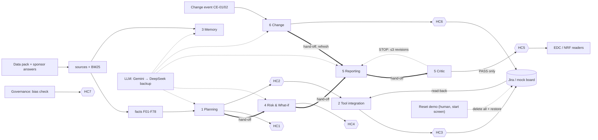

**Team (Group 5, no team name):** Tian Yujia G2510505D (team lead; Design Document and demo system), Qu Chengzhi G2510533D (Evaluation Report), Huang Hao G2510626K (Governance Log), Zhang Yinan G2505943K (demo video), Liu Beiqi G2510916G (slides), Zhao Lingfeng G2510595H. The agent modules have no individual owners; the team lead is responsible for all of them.
**Repository:** `github.com/FrundlesTian/harbourline-pm` (public), branch `main`, latest commit.
**Evidence convention:** `path:lines` refers to the repository; `BRIEF-p3-5`, `SA-Q1`, `EDC-2.3`, `NRF-4.2` etc. are the system's own source IDs (Appendix E). Requirement references `L137` are line numbers in `data_pack/00_Brief_UPDATED.txt`.

---

## 1. Purpose, scope and design principles

Six agent modules and a governance layer plan, track and report the Harbourline refurbishment behind one local web UI (`server.py`) and write the approved plan into Jira Cloud. Requirements come from the UPDATED brief (L137–L201) only.

**Core principle — the LLM drafts, deterministic code decides.** It is implemented as four rules:

1. **Facts are verified, not generated.** Report numbers and dates come from facts `F01–F78`, each rejected at load unless its exact quote is in its source chunk (`app/facts_catalog.py:89-108`); conflict detectors CF01–CF12 compute from them (`app/planning.py:219-281`).
2. **The LLM drafts structured content and must cite.** By default the plan, risk register, report bodies and change analysis are generated as JSON carrying source/fact IDs (`app/planning.py:327-487`, `app/risk.py:173-235`, `app/reporting.py:161-238`, `app/change.py:128-191`; grounding rule `app/gen.py:73-76`).
3. **Validators and a Critic check every draft.** Unknown IDs are dropped, WBS must trace to an in-scope line, a date survives only if a cited source states it (`app/planning.py:423-432`), and the Critic traces every number, date and person in a report to what the line cites (`app/critic.py:82-120`).
4. **A curated baseline is the fallback** when no model is configured or validation fails; the reason is recorded (`app/gen.py:61-66`) and shown on the Overview page. The committed baseline evaluation passes 34 of 34 cases in this mode (`eval/results/latest.md`); the LLM mode also passes 34 of 34 (Evaluation Report).

Human checkpoints HC1–HC7 sit between agent output and anything a stakeholder or the PM tool sees (§4). Open questions and assumptions are kept in the assumption register (**Appendix A**), which the Planning Agent seeds automatically (`app/planning.py:513`).

## 2. Architecture

*Thick arrows (`==>`) are automatic hand-offs, each written to the `handoffs` table by `audit.handoff()` (`app/audit.py:52-57`). Hexagons are human checkpoints; the dotted Reset demo edge is a human maintenance action outside the agents (§5). The full diagram is `docs/design/architecture.mmd`.*

**Stack (as built).** Python 3 standard library only: `ThreadingHTTPServer` (`server.py:482-499`), vanilla HTML/JS front end (`static/`), SQLite for every store including the audit log (`app/db.py`). The LLM client calls OpenAI-compatible chat endpoints and tries providers in order: **Gemini via Google AI Studio first, DeepSeek as backup** (`app/config.py:27-59`, `app/llm.py:66-115`). A failed call is logged and retried on the next provider (`app/llm.py:72-80`). The PM tool is Jira Cloud REST v3, with a local mock board that implements the same contract (`app/pmtool.py:71-135`). Since 11 Nov 2026 there is **no password**, by design for the demo: the start screen lists the active accounts and the user picks one (`app/auth.py:129-148`, `GET /api/identities`); the chosen account's role is then enforced server-side on every call (`app/auth.py:184-202`, `server.py:352-378`). The start screen also offers **Reset demo** (§5). There is no Streamlit UI and no JSONL log; the UI runs locally at `http://127.0.0.1:8000` and opens in English (`app/config.py`, `static/i18n.js`).

**One full run** (`app/pipeline.py:21-33`, `POST /api/run`):

1. `init()` chunks the pack into 415 line-addressed chunks, builds the BM25 index, verifies the facts and restores human decisions (`app/pipeline.py:10-18`).
2. **Planning** generates scope, Sponsor Questions, WBS and milestones, runs the conflict detectors, filters untraceable WBS elements and hands the WBS to Risk (`app/planning.py:490-561`).
3. **Risk** generates the register from the seed register, pack evidence and WBS, validates it, computes what-ifs W1–W3 and hands off to Reporting (`app/risk.py:238-279`).
4. **Governance** recomputes the bias check (`app/governance.py:43-107`).
5. **Reporting** drafts the EDC update and NRF report; the Critic checks each draft, and STOP findings go back to the model up to three times (`app/reporting.py:221-238`).
6. Tokens, cost and seconds are recorded per run (`app/audit.py:89-116`).

Then a person approves HC2, Tool integration shows a read-only diff, a person approves HC3 for that diff, and `apply` writes and reads back (`app/pmtool.py:482-592`). Temperature 0.0 plus a response cache keyed on model chain + prompt (`app/llm.py:34-63`) make a re-run on the same database reproduce the plan, register and board, so HC2/HC4 hashes stay valid.

## 3. Agent cards

Role and Context are fixed in `app/agents.py:9-91` (full text: Appendix B). **Model for every LLM call:** Gemini `gemini-2.5-flash` by default (`app/config.py:33`, set by the team in `.env`), DeepSeek `deepseek-chat` as backup (`app/config.py:42`); temperature 0.0 (`app/llm.py:66`). The Gemini path is tested only against a local stub; every LLM run the team made used DeepSeek, whose use the course instructor has accepted (team statement, 14 Nov 2026).

| **1 Planning Agent** | |
|---|---|
| Role (prompt) | `app/agents.py:10-21`; generation prompts `app/planning.py:327-474` |
| Inputs | Brief chunks, sponsor answers, NRF, EDC, DEL, LL chunks; fact store |
| Outputs | Scope lines SC/OS; Sponsor Questions GQnn with status, answer and assumption; conflict register CF01–CF12; WBS to L3 with dictionary; flagged elements; milestones MSnn with dependencies |
| Tools/APIs | LLM (JSON); validators; conflict detectors (deterministic) |
| Stop condition | Generated plan rejected if <8 scope lines, <10 Sponsor Questions, L1<4 or L3<25, or <8 milestones (`app/planning.py:373-376, 416-417, 472-473`) |
| Failure behaviour | If the answer stops after the scope, the Sponsor Question register is requested once more on its own (`app/planning.py:344-347`). Otherwise falls back to baseline tables; reason shown on Overview and in audit as `output generated (baseline)`, outcome `fallback` (`app/gen.py:61-66`). The optional extra-gaps call is cached like every other call (`app/planning.py:296`) |
| Evidence | Eval T01–T05 (`eval/results/latest.md`); LLM-mode log `docs/evaluation/evidence/eval_llm_deepseek_2026-11-14_final.log` |

| **2 Tool Integration Agent** | |
|---|---|
| Role (prompt) | `app/agents.py:22-30` — "Deterministic agent - no LLM" |
| Inputs | HC2-approved WBS + milestones; HC6-approved change actions |
| Outputs | Preview (create/update/unchanged + `preview_id`), PM issues, read-back report |
| Tools/APIs | Jira Cloud REST v3 (§5) or mock board, both behind `Guarded` (`app/pmtool.py:343-390`) |
| Stop condition | No write without HC2 for the current plan hash and HC3 for the preview (`app/pmtool.py:485-486, 528-531`) |
| Failure behaviour | Refusal returned and logged `pm sync refused` (blocked); Jira errors surface with a hint (401/403/404) and token redacted (`app/pmtool.py:151-172`) |
| Evidence | Eval T21–T23, T30 (mock board) |

| **3 Memory & Retrieval Agent** | |
|---|---|
| Role (prompt) | `app/agents.py:31-40` |
| Inputs | Question; BM25 top hits; decision log DL-nnn |
| Outputs | Answer with document + line citations, or NOT FOUND with reason; conflict notes; `qa_log` row |
| Tools/APIs | BM25 (`app/sources.py:294-332`); LLM optional synthesis |
| Stop condition | Deterministic sufficiency test: top score <2.5, key-term coverage <70%, or no value where one is asked → NOT FOUND (`app/memory.py:76-87`) |
| Failure behaviour | LLM answer with an unknown citation or untraceable number is rejected and logged; extractive answer used instead (`app/memory.py:105-122`) |
| Evidence | Eval T06–T15 |

| **4 Risk & What-if Agent** | |
|---|---|
| Role (prompt) | `app/agents.py:41-51`; generation prompt `app/risk.py:173-202` |
| Inputs | Seed register (RISK-Rnn), pack chunks, WBS hand-off, conflicts |
| Outputs | Register (L×I, owner, trigger, mitigation, WBS links, sources); seed QA findings; what-ifs W1–W3 (+W4 for CE-02) |
| Tools/APIs | LLM (JSON); validators; deterministic seed QA and what-if arithmetic (`app/risk.py:110-126, 301-381`) |
| Stop condition | Risk dropped if L or I outside 1–5, no valid WBS link, no known source, no owner or trigger, or if a number or date in its description or trigger is not stated by its cited sources after one revision round (`app/risk.py:129-170`); register rejected if <12 valid risks (`app/risk.py:214-227`) |
| Failure behaviour | Baseline register used; reason logged. A missing vendor-change risk is added by the validator (`app/risk.py:228-234`) |
| Evidence | Eval T16, T17 |

| **5 Reporting Agent** | |
|---|---|
| Role (prompt) | `app/agents.py:52-62`; report prompt `app/reporting.py:161-194` |
| Inputs | One fact sheet (facts with quotes), conflicts, change events, NRF/DEL chunks; top-5 risks inserted from the register (`app/reporting.py:197-218`) |
| Outputs | EDC exception update and NRF monthly report, each with a claim list (text, cites, calc) |
| Tools/APIs | LLM (JSON); Critic; line templates (`app/reporting.py:67-125`) |
| Stop condition | Draft only — cannot release; hands to Critic automatically (`app/reporting.py:285-287`) |
| Failure behaviour | Still STOPPED after 3 revisions → template draft used and logged `generated draft rejected - template fallback` (`app/reporting.py:249-255`) |
| Evidence | Eval T18, T25 |

| **5 Critic Agent** | |
|---|---|
| Role (prompt) | `app/agents.py:63-71` — "Deterministic agent - no LLM" |
| Inputs | Draft sections, claims, rendered content |
| Outputs | Findings (rule, severity, detail); report status `critic_passed` / `critic_stopped` |
| Tools/APIs | Number/date/person tracer with a safe formula evaluator (`app/critic.py:62-120`) |
| **Blocker rule** | Any finding of severity STOP blocks release: C1 untraceable number/date/person or uncited claim; C3 missing required section; C4 top five ≠ register; C5 superseded fact or unreflected change event; C6 banned status phrase ("on track", "on programme" …) unless attributed to KHB; C7 conflict line with <2 sources; C8 NRF report without NOT FOUND (`app/critic.py:123-169`) |
| **Max revision loops** | **3** for generated report drafts (`MAX_REVISIONS = 3`, `app/reporting.py:151`); **1** for generated change cost lines and for generated risks, after which untraceable lines or risks are dropped (`app/change.py:165-178`, `app/risk.py:137-163`); **0** for template and planted-fault drafts |
| Failure behaviour | STOPPED report is stored with findings; HC5 release refused (`app/reporting.py:291-298`) |
| Evidence | Eval T19 (21/21 planted faults), T20, T28 |

| **6 Change Agent** | |
|---|---|
| Role (prompt) | `app/agents.py:72-81`; analysis prompt `app/change.py:130-158` |
| Inputs | Event JSON (`change_events/CE-01.json`, `CE-02.json`); tags of every stored output |
| Outputs | Stale list; Change Impact Note (cost/time, sponsor decisions, UNRESOLVED); auto-refreshed what-ifs and reports; pending HC6 actions |
| Tools/APIs | Tag matching + milestone dependency walk (deterministic, `app/change.py:38-58, 248-282`); LLM analysis; Critic tracer |
| Stop condition | Never edits baseline, closes or deletes; analysis rejected if <2 traced cost lines or <2 sourced decisions (`app/change.py:208-221`) |
| Failure behaviour | Baseline CE-01/CE-02 analysis used (`app/change.py:65-125`); rejected cost lines logged `reject generated cost line`. If affected risks exist but no valid re-score is proposed, the agent is asked once for re-scores only (`app/change.py:179-188`) |
| Evidence | Eval T24–T28 |

| **Governance layer** | |
|---|---|
| Role (prompt) | `app/agents.py:82-90` — deterministic |
| Inputs | Every agent write and approval; `05_Resident_consultation_responses.csv` |
| Outputs | `audit_log`, `approvals`, CSV exports; bias report B1–B6 with actions |
| Tools/APIs | SQLite; theme lexicon en/zh/ms/ta (`app/governance.py:9-41`) |
| Stop condition | Bias check status "awaiting HC7" until signed off (`app/governance.py:100-112`) |
| Failure behaviour | Unknown checkpoint, unnamed approver or invalid decision raises an error (`app/audit.py:60-66`) |
| Evidence | Eval T20, T23, T29, T30 |

## 4. Human checkpoint map

Checkpoints are defined in `app/audit.py:16-31`. The server records every approval under the selected session account, never a typed name (`server.py:118-143`), and checks that account's role first (`app/auth.py:184-202`). Approvals go to the `approvals` table with approver, role, account, decision, comment and timestamp (`app/db.py:58-60`, migrations `:95-98`) and are mirrored in `audit_log`. **The account is chosen without a password**, so an approval shows which account approved, not which person (limitation L7). The start-screen **Reset demo** deletes the `approvals` table together with the other demo data; the mirrored rows in `audit_log` remain (§7).

| ID | What is approved (bound to) | Shown to the approver | Approver role (RBAC) / name | On reject | If skipped, what is stale or unprotected |
|---|---|---|---|---|---|
| HC1 | Scope + Sponsor Questions register (`gaps_hash`) | Planning page: scope, questions, answers, assumptions, conflicts | project_manager (Project Manager account) | Rejection recorded; plan stays in draft | **Record only:** no code path is blocked by HC1. Questions reach the sponsor unreviewed. |
| HC2 | Plan baseline (`plan_hash` of WBS + milestones) | WBS, dictionary, milestones, dependency issues | project_manager (Project Manager account) | `preview` refuses to run | **Enforced:** no PM sync is possible (`app/pmtool.py:485-486`); any plan change needs re-approval |
| HC3 | One sync diff (`preview_id`) | Per-item create/update/unchanged list | project_manager (Project Manager account) | `apply` refuses (`app/pmtool.py:528-531`) | **Enforced:** no write to Jira. Limitation: §8 L2 |
| HC4 | Risk register version (`risk_hash`) | Register, seed QA, what-ifs | group_leader (Group Leader account) | Rejection recorded | **Record only:** reports still draw top-five risks from an unapproved register |
| HC5 | Release of one report | Report, claims, Critic findings | group_leader (Group Leader account) | Report stays a draft | **Enforced:** only `critic_passed` drafts can be released (`app/reporting.py:291-301`) |
| HC6 | One change action (re-score, PM comment + label, milestone note, assumption update) | Change Impact Note and the action payload | project_manager (Project Manager account) | Action marked rejected; nothing applied | **Enforced:** actions apply only in `approve_action` (`app/change.py:388-431`); risks stay at old scores |
| HC7 | Bias & fairness check BIAS-1 | Findings B1–B6, re-weighted ranks, translations | supervisor (Supervisor account) | Status "rejected" | **Record only:** status shown; no code consumes the consultation summary |

The role strings in `app/audit.py` ("Team PM lead" …) are older labels; the RBAC role is what is checked.

**Not automated, by design.**

- **Moving items to Done, closing, resolving or deleting.** The brief makes these human acts (L247–L248). `Guarded` blocks them and logs `BLOCKED` (`app/pmtool.py:378-390`); the forbidden fields are `status`, `resolution` and `resolutiondate` (`app/pmtool.py:29`). Read-back reports items a human moved to Done (`app/pmtool.py:586`).
- **Sponsor decisions**, such as closure priority (`SA-Q3`), contingency status (`EDC-1.2`) or rooftop deferral (`EDC-6.3`). These appear as decisions with who/when, or as NOT FOUND, never as choices made by the agent (`app/change.py:188-190`).
- **Report release (HC5) and risk re-scoring (HC6).** Agents propose; a person accepts, because the reports go to external bodies and scores drive the top-five list.

## 5. Data contract with the PM tool

| Plan element | PM field | Rule (`app/pmtool.py`) |
|---|---|---|
| WBS L1 / L2 / L3 | Issue type Epic / Task / Subtask | `:41-50`; Jira types resolved by hierarchy level, so localised type names work (`:245-266`) |
| Milestone | Task, summary `[MSnn] Milestone: <name>` | `:52-61` |
| WBS parent | `parent` = parent's issue key | via ext-key map, parents written first (`:539-556`) |
| Dependency | "Blocks" issue link | idempotent; direction learned once and corrected (`:294-317`) |
| Labels | `ai-generated`, ext key, `wbs` or `milestone` | create refused without `ai-generated` (`:356-358`) |
| Due date | `duedate` only for a full ISO date | otherwise the description says the date is NOT FOUND (`:53, 57`) |
| Description | WBS dictionary or milestone note + source citations | `:48, 57` |

**External key and idempotency.** Each item has a stable label key such as `ext-HCH-WBS-1-2-3` (`:37-38`). Sync is (1) lookup by ext key — one search plus a bulk read of keys written before, covering Jira's index lag (`:452-479`); (2) compare a SHA-256 content hash with `pm_sync_map` and the board copy (`:65-67, 515-518`); (3) create, update or no-op (`:543-554`). `change-*` labels from approved HC6 actions survive re-syncs (`:510-512`). Eval T22: second sync 0 created, 0 updated, 92 unchanged.

**Approval bound to the diff.** `preview` hashes the list of (ext key, action, hash) into `preview_id` (`:501`). HC3 approves that ID and `apply` refuses any other (`:528`). `apply` recomputes the actions itself but does not re-check that they still produce the approved ID (limitation L2, §8).

**Read-back reconciliation.** After every apply, `readback` reports missing, mismatched, duplicate, unlabelled and human-Done items, and sets `verified` only if there are no missing, mismatched or duplicate items (`:568-592`).

**Allowed vs refused.**

- **Allowed:** create, update (summary, description, labels, due date, parent), comment, link, and reads.
- **Refused and logged:** delete, close, transition, and any update touching status or resolution (`:363-390`).
- **One exception:** the agent deletes an *issue link* it has just created in the wrong direction, and logs it (`:308-312`). It never deletes an issue.

**Reset demo (maintenance, not an agent operation).** The start screen has a **Reset demo** button that is reachable before choosing an identity (`server.py:408-415`). It is separate from the agents' `Guarded` adapter:

1. **Preview** (`GET /api/reset/preview`, `server.py:49-64`). Lists every issue in the configured Jira project, found by one project search plus the keys in `pm_sync_map`, so items missing from Jira's search index are included (`app/pmtool.py:401-410`). The snapshot (site, project, Jira count, mock count, confirmation text) is hashed into a reset `preview_id`.
2. **Confirm** (`POST /api/reset/restore`, `server.py:67-81`). The user must type the Jira project key, or `RESET` when only the mock board is configured. The server refuses a missing or wrong confirmation (400), a second reset already running (409, `RESET_LOCK`), or a snapshot whose `preview_id` has changed since the preview (409).
3. **Delete** (`app/pmtool.py:413-448`). The issue list is fetched again and must match the preview exactly. Issues are deleted deepest-first with `deleteSubtasks=false`, so nothing is removed by cascade, and each deletion is written to `audit_log`. The first Jira error stops the reset; the local data is then **not** reset and the error reports how many issues were already deleted.
4. **Restore** (`app/pipeline.py:83-100`). Only after all deletions succeed: every demo table, including approvals, decisions, sessions and custom accounts, is cleared; the four default accounts are seeded again; and a baseline run (no LLM) rebuilds the outputs. `audit_log` is kept.

This deletes **every** issue in the project, including issues the system did not create, so it must only be pointed at the team's sandbox project (limitation L8). An offline check on the mock board (14 Nov 2026) confirmed the refusals and that the audit log survives (`docs/governance/evidence/reset_check.json`). The Overview page keeps the older **Reset demo outputs** (admin only, `app/pipeline.py:72-80`), which clears outputs but keeps approvals and decisions.

**Jira endpoints:** the agent uses ten REST v3 endpoints for search, bulk fetch, issue-type metadata, issue create/update, comment, issue links, `myself`, project and link types (`:209-341`; list in Appendix E). Reset demo also calls `DELETE /rest/api/3/issue/{key}`; the agent never does. Rate limits (429/503) are retried using Retry-After (`:162-163`).

**Jira run.** The team's own Jira Cloud site (Free plan, project key `SCRUM`) is the sandbox; the API token is Tian Yujia's. The team ran HC2/HC3-approved writes and read-backs from its demo machine, where the audit and approvals exports are kept (team statement). A read-only snapshot of the project taken from this repository on 14 Nov 2026 (`docs/governance/evidence/jira_snapshot_2026-11-14.json`) shows the result of the latest sync: 92 issues `SCRUM-283`–`SCRUM-374`, created 16:51–16:52 SGT, all labelled `ai-generated`, 92 distinct external keys (no duplicates), 6 Epics / 37 Tasks / 49 Subtasks on a site with Chinese type names (长篇故事 / 任务 / 子任务), 68 items with a parent, 18 milestones and 18 "Blocks" links, all in the initial status. This matches the baseline plan item for item. Keys start at 283, so earlier syncs had already been made and cleared with Reset demo.

**Read before write.** The read path always runs before a write, by construction: `apply` refuses anything but an HC3-approved `preview_id` (`app/pmtool.py:528-531`), and `preview` reads the board first (one JQL search plus a bulk read, `app/pmtool.py:482-501`, `:452-479`). `scripts/jira_check.py` and the PM tool page's **Test Jira connection** (`health()`, `app/pmtool.py:599-612`) are read-only checks of account, project, issue types and link types.

## 6. Change handling and staleness

- **Provenance.** Every stored output carries `tags` from a controlled vocabulary (`app/gen.py:14-16`, `app/db.py:1-2`). Generated items may only use these tags (`app/gen.py:57-58`).
- **Detection.** A change event is injected as a dated, numbered source (`CE-01`) without editing the pack (`app/change.py:236-245`). Its tags come from keyword rules (`app/change.py:21-43`).
- **Matching.** An item is stale when it shares a primary tag with the event, or two broad tags (`app/change.py:251-255`). Milestones downstream of an affected milestone are found by a dependency walk (`app/change.py:51-58`). Stale risks, what-ifs, reports and milestones are written to `stale_items` with a reason (`app/change.py:267-282`). Detected conflicts that match the event by the same rule are always listed as UNRESOLVED in the Change Impact Note, whether or not the generated analysis names them (`app/change.py:285-290`).
- **Refresh without a manual re-run.** What-ifs and report drafts regenerate immediately; the new reports must cite the event or the Critic stops them (C5) (`app/change.py:295-306`; eval T25, T28).
- **Waiting for HC6.** Risk re-scores, milestone notes, assumption updates and PM comment + label changes are drafted as pending actions and applied only after HC6 (`app/change.py:348-431`). An approved re-score makes the live reports stale and regenerates them (`app/change.py:399-405`; eval T26).

**Week 12 run.** The team's event is **CE-01** (odd last digit of the team lead's matriculation number, G2510505D). The team confirmed that the wording in `change_events/CE-01.json` matches the Week 12 Guide. The team ran CE-01 on its demo machine, where the records are kept (team statement, 14 Nov 2026); the committed evidence is the evaluation run (eval T24–T28, baseline mode) and the governance demonstration run (`docs/governance/evidence/change_impact_CE-01.md`).

## 7. Governance, responsible AI and free-tier compliance

**Audit log.** `audit_log(id, ts, run_id, actor, actor_type agent|human|system, action, target_type, target_id, outcome ok|blocked|rejected|fallback|error, detail JSON)` is defined at `app/db.py:61-64` and written by `audit.log()` (`app/audit.py:43-49`). Approvals and hand-offs have their own tables. Audit and approvals export as CSV, and each export is itself logged (`server.py:432-442`). Nothing in the application deletes `audit_log` rows. **Reset demo outputs** (Overview, admin only) keeps approvals and the decision log (`app/pipeline.py:72-80`); **Reset demo** on the start screen clears approvals and decisions as well but keeps `audit_log`, which already mirrors every approval (`app/pipeline.py:83-100`). Export the approvals CSV before a reset if the table itself is needed. Eval T30: 92 PM write rows for 92 issues; no unnamed approvals.

**Guardrails.** One project key, with agent search scoped to project + `ai-generated` (`app/pmtool.py:319-320`); the label is enforced on every create (`:357-358`); no Done/close/delete by agents (§4); unknown API paths default to the most restrictive permission (`server.py:370-378`), except the start-screen calls `/api/identities`, `/api/reset/preview` and `/api/reset/restore`, which are answered before any session check (`server.py:408-415`); generated IDs, scores, dates and numbers are validated before storage (§3).

**Token hygiene.** Keys come only from the environment or a git-ignored `.env` (`app/config.py:13-24`); `.env.example` holds no values; `audit.redact()` masks token patterns before logging (`app/audit.py:33-40`); the Jira health check returns `token_set` as a boolean only (`app/pmtool.py:599-612`); LLM keys travel only in the request header (`app/llm.py:84-91`). A history scan found no committed credential.

**Bias and fairness check** (`app/governance.py:43-107`). The 214 consultation responses are theme-tagged in four languages; raw theme ranks are compared with age-re-weighted and English-only ranks, and channel, age and language skew is reported (B1–B6). Results: residents 65+ are under-represented, an English-only summary would drop most active-ageing and lift comments, and re-weighting changes the top-four order (eval T29). Five actions follow, including holding the summary (D15) for HC7. **What changed as a result:** at HC7 the team approved and carried out the actions except the most critical one, the second consultation round for residents 55+, which was not approved (Governance Log §3).

**Tools and free tiers.**

| Tool | Used for | Tier / cost | Brief status |
|---|---|---|---|
| Gemini via Google AI Studio (`gemini-2.5-flash`, configurable) | Primary LLM for all generation | Free tier; price set to 0 (`app/config.py:37-38`) | Permitted (L210-L212) |
| DeepSeek `deepseek-chat` | Backup LLM, used only when Gemini fails | Pay-per-token; about US$0.026 per full fresh run (LLM-mode evaluation, 14 Nov 2026) | Not on the brief's list (L210-L212); **use accepted by the course instructor** (team statement). It can be switched off with `HCH_LLM_ORDER=gemini`; every required feature also runs in baseline mode at 0 tokens (`eval/results/latest.md`) |
| Jira Cloud (team's own site, project `SCRUM`) | PM tool | Free plan | Recommended (L232) |
| Python 3 stdlib, SQLite, vanilla JS | Code, storage, UI | Free | Permitted ("with code or without it", L205) |
| OpenAI Agent Builder / ChatGPT agent mode | Not used | — | Prohibited (L239-L240); no such dependency |

The vendor-change risk is logged: R23 in the baseline, and enforced by the validator in generated registers (`app/risk.py:104-106, 228-234`). The team re-checked the Gemini, DeepSeek and Jira terms in Week 12 and found no change that affects the project (team statement, 14 Nov 2026).

## 8. Design trade-offs and limitations

| # | Decision | Alternative rejected | Reason | Cost |
|---|---|---|---|---|
| T1 | LLM generates structured JSON; deterministic validators and Critic decide; curated baseline as fallback | Free-text LLM output reviewed by people only | Every number becomes checkable; failures degrade to a known-good output, not a blank page | Generated plans differ between fresh databases (only the per-DB cache makes re-runs identical); baseline tables must be maintained |
| T2 | Plain Python stdlib orchestration | OpenAI Agents SDK, CrewAI or LangChain (permitted, L229-L230) | No dependencies to install; hand-offs and gates are explicit code and logged | No framework tracing or tool-calling; the team writes its own loop (the Critic revision loop) |
| T3 | Mock board with the same contract as Jira | Jira-only development | Evaluation and demos run offline without touching the sandbox | Mock evidence is not Jira evidence (§5) |
| T4 | Re-scores and change updates wait for HC6 | Auto-apply re-scores | Scores drive the top-five list in external reports; the brief asks for actions drafted for a human | Stale scores persist until someone approves |
| T5 | BM25 + rule-based sufficiency test for NOT FOUND | Embedding search + LLM judgement | Deterministic, explainable, works with no LLM | Brittle on paraphrase; one case found and fixed (L3) |
| T6 | Tag-based staleness + milestone dependency walk | Full provenance graph per claim | Simple and auditable; tags are validated against one vocabulary | Coarse: may over-flag; WBS rows are flagged, not regenerated |
| T7 | Passwordless identity selection and a one-click project reset on the start screen, added 11 Nov 2026 | Password login (commit `8044577`); manual clean-up in Jira between demo runs | Faster demonstrations: switching role to show RBAC takes one click, and a demo can be repeated from a clean board | Approvals no longer prove who approved (L7); anyone who can open the page can empty the sandbox project (L8) |

**Known limitations.**

- **L1: Generated Sponsor Questions recall. Kept.** In LLM mode the generated register recalls 77–82% of the team's 22 gold gaps across runs, 82% in the final run; baseline mode recalls 91%. The team's own target is 80%; the course instructor later confirmed a lower threshold, which every run meets, according to the team. The evaluation checks that once pinned baseline IDs were rewritten as behaviour checks, and LLM mode now passes 34 of 34 (`docs/evaluation/evidence/`).
- **L2: HC3 diff binding. Accepted by the team.** `apply` does not verify that the current diff still hashes to the approved `preview_id`, so a plan changed after HC3 but re-approved at HC2 could be written under an older HC3 (`app/pmtool.py:526-565`).
- **L3: Memory false NOT FOUND. Fixed 14 Nov 2026.** "How often does the EDC meet?" used to return NOT FOUND although `EDC-1.6` and `EDC-2.3` answer it, because "often" was counted as a key term. Frequency questions are now recognised and must be answered by a sentence that states a frequency such as weekly or fortnightly (`app/memory.py`). The answer cites both sources; eval T34 checks it.
- **L4: Checkpoints that only record. Accepted by the team.** HC1, HC4 and HC7 are recorded and shown but gate no code path (§4).
- **L5: Evidence not in the repository.** The Jira approvals and the team's Week 12 run are recorded on the team's demo machine, not in the repository; the repository holds a read-only Jira snapshot. Gemini has not been run; all LLM evidence uses DeepSeek.
- **L6: Partial stretch items.** The three what-ifs are shown as cards, not a comparison table. Re-scoring is triggered by change events, not by arbitrary plan edits.
- **L7: Passwordless demo identities.** Anyone who can reach the app can select an active account, including admin. Role permissions still apply to the selected session, but approvals are not proof of a person's identity. This reopens governance incident I-04 (Governance Log §5). Use a protected local demo environment; restore authentication (still in history at commit `8044577`) before using this workflow outside the team. **Team decision (14 Nov 2026): accepted**, because the team alone controls the demo machine; approvals are attributed to role accounts, not named people.
- **L8: Project-wide reset.** Anyone who can reach the identity screen can preview and confirm deletion of every issue visible to the configured Jira account in the selected project. The operation is irreversible and may partially complete if Jira refuses a later deletion. The local baseline is restored only after all requested Jira deletions succeed. The reset also clears the `approvals` and `decisions` tables; `audit_log` keeps the history. The Jira-side deletion has not been run in this repository's evidence; only the mock-board path was checked. **Team decision (14 Nov 2026): accepted**, because `SCRUM` is the team's own sandbox and holds only system items; approvals are exported before a reset.

---

# Appendix A — Assumption register

**Seeding.** There is no standalone assumption file. The register is the Sponsor Question table:

- Every question not answered by a source gets `ASSUMPTION A-nn: until the sponsor answers, plan treats this as unresolved…` (`app/planning.py:513`).
- Approved HC6 actions append event notes, for example "(CE-01)" (`app/change.py:420-427`).
- The rows below are the **baseline** register (`app/planning.py:45-181`, GQ01–GQ20). In LLM mode the IDs and wording are regenerated on each fresh database; the live register is on the Planning page.
- Rows marked **(added)** cover G01–G14 items that the baseline register does not hold as a question.

Owners are role accounts; owners and revisit triggers were adopted by the team lead.

| ID | Assumption or open question | Source(s) | Sponsor answer | Impact | Owner | Revisit trigger |
|---|---|---|---|---|---|---|
| A-01 | Fixed completion date: 22 months from possession vs fully open by Q4 2028 vs KHB 2028-12-31 vs D22 2028-10-31 | BRIEF-p3-5, EDC-4.1, DEL-D22, NRF-4.2 | SA-Q1 confirms possession from 4 Jan 2027; no single completion date given — remains assumption | Schedule; NRF approval needed after 31 Dec 2028 | project_manager | Programme revision or NRF 4.2 request |
| A-02 | Grant is 60% of eligible cost capped at S$17.0M (max S$10.2M), not 60% of S$18.5M | BRIEF-p3-5, NRF-1.1, NRF-1.2, NRF-1.3 | Unanswered — remains assumption | Council share above 40% of the budget (derived: 18.5 − 10.2 = S$8.3M) | Finance | Fund eligibility ruling (e.g. CE-01) |
| A-03 | ~S$1.18M headroom is not yet contingency; drawdown authority undecided | EDC-1.1, EDC-1.2 | Unanswered — remains assumption | Asbestos S$0.35–0.60M would use 30–51% of it | Finance | EDC decision on contingency |
| A-04 | Childcare handover needed about 7 months before the Jan 2029 intake vs programme month 20 | BRIEF-p3-6, EDC-4.1, DEL-D21, LL-L04 | Unanswered — remains assumption | Childcare opening and T3/T4 timing | project_manager | Operator licensing plan |
| A-05 | No closures are agreed; east-core closure would break barrier-free access to L3–4 | BRIEF-p3-6, EDC-3.1, NRF-5.1 | SA-Q3: no closures agreed; priority is the sponsor's | 6–8 weeks delay if lift works slip (PR3-3) | Sponsor | Closure decision at EDC |
| A-06 | Active ageing operator appointed by Council; EOI needs 3 responses, has 1 | EDC-4.4, DEL-D14 | SA-Q2: Council appoints; no confirmed date | Tranche 2 needs ALL operator agreements (NRF-T2) | Community Engagement | EOI close 2027-04-30 or CE-02 |
| A-07 | Asbestos removal eligibility unknown | EDC-5.1, EDC-6.5, PR3-4 | Unanswered — remains assumption (CE-01 rules it ineligible if that event applies) | Council exposure 40–100% of S$0.35–0.60M (W1) | Finance | Fund ruling |
| A-08 | Rooftop garden kept or deferred; garden ineligible; slab strengthening unpriced | NRF-1.3, EDC-5.2, EDC-6.3 | Unanswered — remains assumption | Cost NOT FOUND; W3 | Sponsor | EDC vote |
| A-09 (added) | EDC cadence: weekly (brief) vs fortnightly from February with alternate-week written updates | BRIEF-p3-7, EDC-1.6, EDC-2.3 | Unanswered — remains assumption | Reporting calendar for the EDC update | project_manager | Next EDC terms of reference |
| A-10 (added) | Monthly NRF report due by the 10th working day; February report was late; a second late report risks suspension | NRF-3.1, NRF-3.3, DEL-D09 | Not a sponsor question (data pack rule) | Tranche suspension | group_leader | Each monthly deadline |
| A-11 (added) | KHB "broadly on programme" is treated as a claim, not a status; figures show −2.5% physical, −9% design | PR3-1, PR3-2 | n/a | Reports must attribute the wording to KHB (Critic C6) | group_leader | Each contractor report |
| A-12 (added) | Seed register defects (R01 owner left, R03/R04 duplicate, R06 score error, R08 closed but realised, R11 no owner) are repaired, not inherited | RISK-R01, RISK-R03, RISK-R04, RISK-R06, RISK-R08, RISK-R11 | n/a | Register accuracy | group_leader | HC4 |
| A-13 (added) | Deliverables schedule data defects (mixed date formats, D06 no due date, D20 no actual date, D14 no owner) are flagged, not corrected | DEL-D03, DEL-D06, DEL-D10, DEL-D14, DEL-D20 | n/a | Milestone dates; T2 owner | project_manager | Next schedule issue from KHB |
| A-14 (added) | Values the pack does not contain stay NOT FOUND: Finance Manager funding figures, temporary lift price, roof strengthening cost, garden cost, energy target | EDC-3.5, EDC-3.2, EDC-5.2, BRIEF-p3-3 | Unanswered — remains assumption | What-ifs W2/W3 show NOT FOUND | Finance | Sponsor provides figures |

*Full baseline GQ01–GQ20 register, with status, sponsor answer and assumption: `docs/design/evidence/sponsor_questions_register_baseline.csv`. Its `gaps_hash` is `072aec9495dc`, the hash approved at HC1 in the demonstration run. Only Round 1 sponsor answers exist in the data pack (`data_pack/00_Sponsor_Answers_Round1.txt`).*

# Appendix B — Agent prompts: Role and Context as stored

Source: `app/agents.py`. No tokens appear in any prompt.

**Shared grounding text** (`app/agents.py:4-7`): "You may ONLY use the SOURCES given in the user message. Never use outside knowledge. If the sources do not contain the answer, say exactly NOT FOUND. Every claim must carry a citation in square brackets using the source id, e.g. [EDC-5.1]. When sources conflict, say so and cite both."

**Generation grounding** (`app/gen.py:73-76`): "Use ONLY the SOURCES given. Never use outside knowledge or invent names, dates, amounts or owners. Every source id you output must be one of the ids shown in square brackets. If the sources do not state something, write NOT FOUND […] instead of guessing. Where sources disagree, say so and cite both. Return a single JSON object only."

| Agent | Role | Context | System prompt |
|---|---|---|---|
| Planning | Project planner for the Harbourline Community Hub Refurbishment. | Brief + Sponsor Answers Round 1 + data pack only. Relative time until the sponsor gives dates. | "You are the Planning Agent. " + grounding; generation: "You are the Planning Agent for the Harbourline Community Hub Refurbishment. " + generation grounding (`app/planning.py:323-324`) |
| Tool Integration | Writes the approved plan into the PM tool and reads it back. | Approved WBS/milestones only (HC2). One sandbox project. Label ai-generated. Stable external keys. | "Deterministic agent - no LLM." |
| Memory & Retrieval | Answers questions over the pack with document + line citations. | BM25 retrieval over chunks; human-approved decisions are carried forward between sessions. | "You are the Memory Agent for the Harbourline project. " + grounding + " Answer in at most 4 sentences." |
| Risk & What-if | Maintains the scored risk register and runs what-if scenarios. | Seed register (2025) + pack evidence + WBS (hand-off from Planning). | "You are the Risk & What-if Agent. " + grounding; generation prompt `app/risk.py:180-202` |
| Reporting | Drafts the weekly EDC exception update and the monthly NRF progress report from ONE fact sheet. | Fact store + risk register + tranche conditions. Audience-fit: EDC = one-page exception report (L07); NRF = clause 3.2 contents. | Summary: "You are the Reporting Agent. Rewrite the given bullet facts into a short executive summary. Do not add any number, date, name or claim that is not in the bullets. Keep the [F..] fact tags." Generation prompt with drafting rules: `app/reporting.py:167-192` |
| Critic | Checks every draft before a human sees it. | Fact store, risk register, required report contents, stale-fact list. | "Deterministic agent - no LLM." |
| Change | Responds to the Week 12 change event. | Event text (dated, numbered) + every stored output's tags. | "You are the Change Agent. " + grounding; analysis prompt `app/change.py:130-158` |
| Governance | Audit log, checkpoints, guardrails, bias and fairness check. | All agent writes; consultation CSV. | "Deterministic." |

The UI translation helper (`app/translation.py`) has its own display-only prompt and never feeds an agent.

# Appendix C — Coverage table, updated 14 Nov 2026

Status: **Implemented** = code + run evidence in the repo; **Partial** = code exists but part of the requirement or its evidence is missing.

| # | Requirement | Brief ref | Status | Evidence | Note |
|---|---|---|---|---|---|
| 1.1 | Scope statement + Sponsor Questions | L137-143 | Implemented | `app/planning.py:327-377, 574-584`; T01 | LLM-mode recall 77–82% (L1) |
| 1.2 | WBS to L3 + dictionary | L137-143 | Implemented | `app/planning.py:380-420, 564-571`; T04 (baseline 49 L3; LLM 61 L3 in the final run) | |
| 1.3 | Milestones with dependencies | L137-143 | Implemented | `app/planning.py:435-474, 595-605`; T05 | |
| 1.S | Traceable WBS; untraceable flagged | L137-140 | Implemented | `app/planning.py:518-536`; T03 | |
| 2.1 | Write WBS + milestones behind confirmation | L145-150 | Implemented | `app/pmtool.py:482-565`; T21, T22 (mock); Jira snapshot of `SCRUM` | 92 items on Jira; approval exports on the team machine |
| 2.2 | Board read back | L149-150 | Implemented | `app/pmtool.py:568-592`; T22 | Jira read-back run by the team (team statement) |
| 2.S | Stable external keys | L145-148 | Implemented | `app/pmtool.py:37-38, 452-479`; T22 | |
| 2.x | Approval bound to the diff | writer brief §5 | Partial | `app/pmtool.py:501, 528` | L2 |
| 3.1 | Answers with document + line citation | L152-155 | Implemented | `app/memory.py:100-139`, `app/sources.py:249-255`; T06–T09 | |
| 3.S1 | NOT FOUND when silent | L152-154 | Implemented | `app/memory.py:76-87`; T10–T13, T34 | L3 fixed |
| 3.S2 | Decisions carried across sessions | L154-155 | Implemented | `app/memory.py:142-154`, `app/pipeline.py:13`; T15 | |
| 4.1 | Scored register, owners, triggers, linked to work | L157-163 | Implemented | `app/risk.py:173-279`; T16 | |
| 4.2 | One what-if with cost + schedule | L160-163 | Implemented | `app/risk.py:301-381`; T17 | |
| 4.S1 | Three what-ifs compared | L157-158 | Partial | W1–W3 `app/risk.py:311-357` | No comparison output |
| 4.S2 | Automatic re-scoring | L158-159 | Partial | `app/change.py:150-151`, `app/risk.py:394-419`; T26 | Event-driven; applied after HC6 |
| 5.1 | Two reports from the same facts | L177-183 | Implemented | `app/reporting.py:161-288`; T18 | |
| 5.2 | Critic before a human; stop condition | L180-183 | Implemented | `app/critic.py:123-169`, `app/reporting.py:221-238, 291-298`; T19, T20 | Revision loop max 3 |
| 5.S1 | Critic findings logged | L177 | Implemented | `app/reporting.py:231-233, 285-287` | |
| 5.S2 | A report the Critic stopped | L178-179 | Implemented | `eval/faults.py`; T19, T28 | Planted faults |
| 6.1 | Detect the Week 12 change | L185-190 | Implemented | `app/change.py:236-245`; T24, T27 | Team's event is CE-01; team run on the demo machine (team statement) |
| 6.2 | Show what is stale | L186-189 | Implemented | `app/change.py:248-282`; T24 | |
| 6.3 | Draft actions for a human | L189-190 | Implemented | `app/change.py:348-431`; T26 | |
| 6.S | Stale outputs refresh without re-run | L185-187 | Implemented (partial scope) | `app/change.py:295-306`; T25 | WBS/milestones via HC6 |
| G.1 | Named human checkpoints | L192-196 | Implemented | `app/audit.py:16-31`, `server.py:118-143` | HC1/HC4/HC7 record only (L4); approver is an account chosen without a password (L7) |
| G.2 | Audit log of every agent write | L193-194 | Implemented | `app/audit.py:43-49`; T30 | Planning logs one summary row per run |
| G.3 | Never delete/close/Done | L194-196 | Implemented | `app/pmtool.py:343-390`; T23 | Agents only. Link-direction fix disclosed; the human Reset demo deletes all project issues (L8) |
| G.S | Bias and fairness check | L192-194 | Implemented (acted on) | `app/governance.py:43-112`; T29 | HC7: all actions but the second consultation round |
| I.1 | Hand-off without human copying | L199-200 | Implemented | `app/audit.py:52-57`; T31 | |
| I.2 | Every approval point designed in | L200-201 | Implemented | §4 | L4 |
| R.1 | Free tiers only | L206-207 | Implemented (approved exception) | `app/config.py:27-59`; baseline 0 tokens | Jira Free; DeepSeek is paid, accepted by the course instructor |
| R.2 | One sandbox project | L245 | Implemented | `app/config.py:72`, `app/pmtool.py:319-320` | Project `SCRUM` on the team's own site |
| R.3 | `ai-generated` label | L245-246 | Implemented | `app/pmtool.py:357-358, 585` | |
| R.4 | Personal tokens | L249-250 | Implemented | `app/audit.py:33-40`, `.gitignore`; history scan clean | Jira token and LLM keys are Tian Yujia's |
| R.5 | Read path before write access | L251 | Implemented | `app/pmtool.py:482-501, 528-531, 599-612`, `scripts/jira_check.py` | Enforced: every write needs a preview, which reads first (§5) |
| R.6 | No Agent Builder / agent mode | L239-240 | Implemented | stdlib only | |
| R.7 | Vendor-change risk logged | L240-241 | Implemented | `app/risk.py:104-106, 228-234` | Week 12 re-check done, no change (team) |
| R.8 | Code orchestration tool | L229-230 | Note | Plain Python | Trade-off T2 |

**Counts (37 rows):** 33 Implemented, including the "(partial scope)", "(acted on)" and "(approved exception)" variants; 3 Partial (2.x, 4.S1, 4.S2); 1 note. Planned 0, Missing 0. Since the 8 Nov version, 2.1, 2.2, 2.S, R.1, R.2 and R.5 moved to Implemented on the evidence of the Jira snapshot, the code-enforced read path and the team's statements (14 Nov 2026).

# Appendix D — AI-use declaration

| Deliverable | AI tools and what they produced | Human review |
|---|---|---|
| Design document (this file, `architecture.mmd`, inventory, claims trace, open items) | Claude (Anthropic, Claude Code, model Opus 5.5) drafted the text, tables and diagram from the repository and data pack, 8 Nov 2026, and updated them on 14 Nov 2026 | Tian Yujia (owner) reviewed the content against the system |
| System code (`app/`, `server.py`, `static/`, `scripts/`) | Claude (Claude Code) wrote code including LLM generation and the Gemini/DeepSeek provider chain; the passwordless identities and Reset demo by Tian Yujia with Claude | Tian Yujia (demo system owner) |
| Agent prompts (`app/agents.py`, inline generation prompts) | Claude (Claude Code) | Tian Yujia |
| Runtime outputs (plan, register, reports, change analysis) | DeepSeek at run time (Gemini configured as primary but not used), validated by deterministic code | HC1–HC7 approvals by the role accounts (§4) |
| Evaluation report | Updated by Claude (Claude Code) on 14 Nov 2026 after re-running the harness; owner Qu Chengzhi | Qu Chengzhi |
| Governance log | Updated by Claude (Claude Code) on 14 Nov 2026 after regenerating the demonstration evidence; owner Huang Hao | Huang Hao |
| Slides | Liu Beiqi; ChatGPT used to check the slides for errors | Liu Beiqi |
| Demo video | Zhang Yinan | Zhang Yinan |

# Appendix E — Source-ID and WBS-code conventions

| ID pattern | Meaning | Example | Defined in |
|---|---|---|---|
| `BRIEF-p<page>-<para>` | Brief paragraph | `BRIEF-p3-5` | `app/sources.py:53-77` |
| `SA-Q<n>` | Sponsor Answers Round 1 | `SA-Q3` | `app/sources.py:80-102` |
| `EDC-<item>` | EDC minutes item | `EDC-2.3` | `app/sources.py:105-133` |
| `PR1-/PR2-/PR3-<§>` | Contractor report Jan/Feb/Mar 2027 | `PR3-3` | `app/sources.py:136-151` |
| `DEL-D<nn>` | Deliverables schedule row | `DEL-D22` | `app/sources.py:194-210` |
| `RISK-R<nn>` | Seed risk register row | `RISK-R08` | as above |
| `RC-RC<nnn>` | Consultation response | `RC-RC002` | as above |
| `LL-L<nn>` | Seabreeze lesson | `LL-L04` | `app/sources.py:154-165` |
| `NRF-<clause>` / `NRF-T<n>` | Grant schedule clause / tranche | `NRF-4.2`, `NRF-T2` | `app/sources.py:168-191` |
| `F<nn>` | Verified fact with exact quote | `F24` | `app/facts_catalog.py` |
| `CE-<nn>` / `DL-<nnn>` | Change event / human decision | `CE-01`, `DL-001` | `app/change.py:236-245`, `app/memory.py:142-149` |
| `CF<nn>` | Conflict register | `CF12` | `app/planning.py:219-281` |
| `SC<nn>` / `OS<nn>` | Scope line in / out of scope | `SC03` | `app/planning.py:330-331` |
| `GQ<nn>` / `A-<nn>` | Sponsor Question / its assumption | `GQ09` → `A-09` | `app/planning.py:513` |
| `MS<nn>` | Milestone; `M+n` = months from site possession | `MS07`, `M+22` | `app/planning.py:440` |
| `R<nn>` | Live risk (R01–R14 keep seed IDs; R15+ new) | `R22` | `app/risk.py:185` |
| `W<n>` | What-if scenario | `W1` | `app/risk.py:301-357` |
| `HC<n>` | Human checkpoint | `HC3` | `app/audit.py:16-31` |
| `B<n>` | Bias finding | `B3` | `app/governance.py:66-91` |
| `ext-HCH-WBS-<code>` / `ext-HCH-MS<nn>` | PM external key (label) | `ext-HCH-WBS-1-2-3` | `app/pmtool.py:37-38` |

**WBS codes:** `1` (Level 1, Epic) → `1.2` (Level 2, Task) → `1.2.3` (Level 3, Subtask); no Level 4 (`app/planning.py:386`). Owners `UNASSIGNED (<why>)` are kept visible, not filled in.

**PM tool endpoints (Jira Cloud REST v3, `app/pmtool.py:209-341`):**

| Method | Endpoint |
|---|---|
| GET | `/rest/api/3/search/jql` |
| POST | `/rest/api/3/issue/bulkfetch` |
| GET | `/rest/api/3/issue/createmeta/{key}/issuetypes` |
| POST, PUT | `/rest/api/3/issue`, `/rest/api/3/issue/{key}` |
| POST | `/rest/api/3/issue/{key}/comment` |
| GET | `/rest/api/3/issue/{key}?fields=issuelinks` |
| POST, DELETE | `/rest/api/3/issueLink`, `/rest/api/3/issueLink/{id}` |
| GET | `/rest/api/3/myself` |
| GET | `/rest/api/3/project/{key}` |
| GET | `/rest/api/3/issueLinkType` |
| DELETE | `/rest/api/3/issue/{key}?deleteSubtasks=false` (Reset demo only, `app/pmtool.py:441`; never the agent) |
